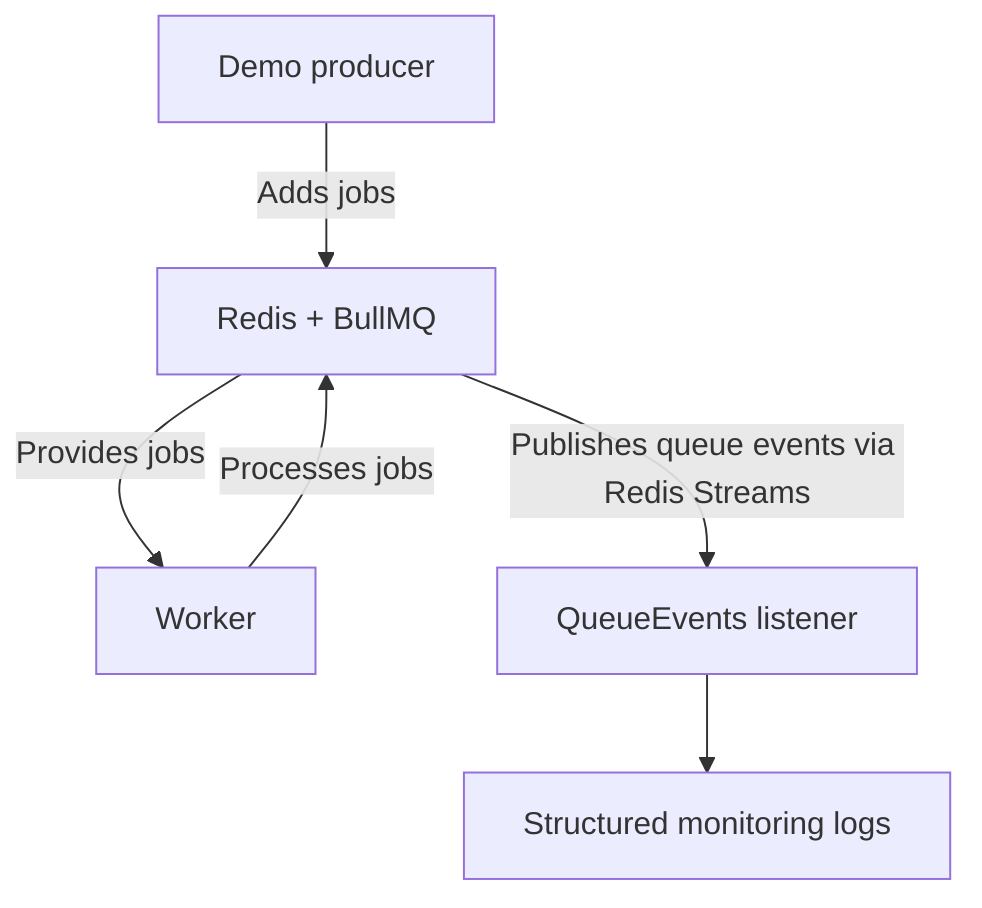

# Lecture 11 — BullMQ Job Events, QueueEvents & Real-Time Monitoring
> **Goal:** Observe job lifecycle events centrally, capture progress and failures, and build the foundation for real-time monitoring of our background processing system.
We will continue with your existing Node.js, TypeScript, Express, Redis, and BullMQ project. We will not add AI or replace the existing queue architecture.
> **Learning workflow:** Build → Test → Break intentionally → Understand → Fix → Verify.
## Table of Contents

1. [Why queue events matter](#1-why-queue-events-matter)
2. [Worker events versus QueueEvents](#2-worker-events-versus-queueevents)
3. [Architecture](#3-architecture)
4. [Create the QueueEvents listener](#4-create-the-queueevents-listener)
5. [Register the listener in the worker process](#5-register-the-listener-in-the-worker-process)
6. [Build and start](#6-build-and-start)
7. [Test job lifecycle events](#7-test-job-lifecycle-events)
8. [Test progress events](#8-test-progress-events)
9. [Test failed-job events](#9-test-failed-job-events)
10. [Test delayed-job events](#10-test-delayed-job-events)
11. [Intentional break test](#11-intentional-break-test)
12. [Production considerations](#12-production-considerations)
13. [Success criteria](#13-success-criteria)

## 1. Why queue events matter
So far, our worker prints messages when jobs start, finish, or fail. That is useful, but it only tells us what a particular worker observes.
In a production system, we want to answer questions such as:
- How many jobs completed?
- Which jobs failed?
- When did a job become active?
- How far has a long-running job progressed?
- Are jobs waiting too long?
- Are retries increasing?
- Is the queue falling behind?
BullMQ emits events that help us observe these transitions without mixing monitoring logic into every job processor.
## 2. Worker events versus QueueEvents
These two mechanisms have different purposes.
| Mechanism | Scope | Typical use |
|---|---|---|
| **Worker events** | A particular worker instance | Log processing errors and completed jobs |
| **QueueEvents** | Events for a queue, observed through Redis Streams | Centralized queue monitoring across workers |
For example, a worker can emit a completed event when it completes a job. A separate QueueEvents listener can observe the queue's completion event without being inside that worker's processor.
> **Important:** QueueEvents requires a Redis connection and uses Redis Streams internally. Its listener must be started and closed as part of the application lifecycle.
## 3. Architecture
We will create a centralized event listener for the existing demo-job queue.


Both components connect to the same queue. QueueEvents can observe events from jobs processed by other workers too.

BullMQ documents QueueEvents as the queue-wide event mechanism, implemented using Redis Streams. Its stream is trimmed automatically by default, so it is an event transport—not a permanent audit log.

Our event listener will log:
- waiting
- active
- progress
- completed
- failed
- delayed
- stalled
- listener errors
We will use structured logs, consistent with the existing project logging style.

## 4. Create the QueueEvents listener
Create a separate file so event monitoring does not become mixed into the worker processor.
**Create file:** `src/queues/demo.queue-events.ts`
```ts
import {
  QueueEvents
} from "bullmq";

import {
  DEMO_QUEUE_NAME
} from "./demo.queue.js";

import {
  createBullMQConnection
} from "./bullmq.connection.js";

import {
  logger
} from "../logging/logger.js";

export const demoQueueEvents =
  new QueueEvents(
    DEMO_QUEUE_NAME,
    {
      connection:
        createBullMQConnection(null)
    }
  );

demoQueueEvents.on(
  "waiting",
  ({ jobId, prev }) => {
    logger.info(
      "BullMQ job waiting",
      {
        queue: DEMO_QUEUE_NAME,
        jobId,
        previousState: prev
      }
    );
  }
);

demoQueueEvents.on(
  "active",
  ({ jobId, prev }) => {
    logger.info(
      "BullMQ job active",
      {
        queue: DEMO_QUEUE_NAME,
        jobId,
        previousState: prev
      }
    );
  }
);

demoQueueEvents.on(
  "progress",
  ({ jobId, data }) => {
    logger.info(
      "BullMQ job progress",
      {
        queue: DEMO_QUEUE_NAME,
        jobId,
        progress: data
      }
    );
  }
);

demoQueueEvents.on(
  "completed",
  ({ jobId, returnvalue }) => {
    logger.info(
      "BullMQ job completed",
      {
        queue: DEMO_QUEUE_NAME,
        jobId,
        returnvalue
      }
    );
  }
);

demoQueueEvents.on(
  "failed",
  ({ jobId, failedReason }) => {
    logger.error(
      "BullMQ job failed",
      {
        queue: DEMO_QUEUE_NAME,
        jobId,
        failedReason
      }
    );
  }
);

demoQueueEvents.on(
  "delayed",
  ({ jobId, delay }) => {
    logger.info(
      "BullMQ job delayed",
      {
        queue: DEMO_QUEUE_NAME,
        jobId,
        delay
      }
    );
  }
);

demoQueueEvents.on(
  "stalled",
  ({ jobId }) => {
    logger.warn(
      "BullMQ job stalled",
      {
        queue: DEMO_QUEUE_NAME,
        jobId
      }
    );
  }
);

demoQueueEvents.on(
  "error",
  (error) => {
    logger.error(
      "BullMQ QueueEvents listener error",
      {
        queue: DEMO_QUEUE_NAME,
        error: error.message
      }
    );
  }
);

export const startDemoQueueEvents =
  async (): Promise<void> => {
    await demoQueueEvents.waitUntilReady();

    logger.info(
      "BullMQ QueueEvents listener ready",
      {
        queue: DEMO_QUEUE_NAME
      }
    );
  };

export const closeDemoQueueEvents =
  async (): Promise<void> => {
    await demoQueueEvents.close();

    logger.info(
      "BullMQ QueueEvents listener closed",
      {
        queue: DEMO_QUEUE_NAME
      }
    );
  };
```

### Understand the event payloads

The events do not all have the same payload.

| Event | Useful fields  |
| --- | --- |
| waiting | jobId, previous state |
| active | jobId, previous state |
| progress | jobId, previous data |
| completed |jobId, serialized return value |
| failed | jobId, failure reason |
| delayed |  delayed timestamp information |
| stalled |  jobId |

These are queue-event payloads, not complete Job objects. For full job details, use the existing job status service. See the BullMQ event documentation.

## 5. Register the listener in the worker process
We want the event listener to start with the worker and close during graceful shutdown.
**Replace file:** `src/workers.ts`
```ts
import {
  demoWorker
} from "./workers/demo.worker.js";

import {
  startDemoQueueEvents,
  closeDemoQueueEvents
} from "./queues/demo.queue-events.js";

import {
  logger
} from "./logging/logger.js";

let isShuttingDown = false;

const start =
  async (): Promise<void> => {
    try {
      await startDemoQueueEvents();

      logger.info(
        "Worker process started"
      );
    } catch (error) {
      logger.error(
        "Worker process startup failed",
        {
          error:
            error instanceof Error
              ? error.message
              : String(error)
        }
      );

      await demoWorker.close();

      process.exitCode = 1;
    }
  };

const shutdown =
  async (
    signal: string
  ): Promise<void> => {
    if (isShuttingDown) {
      logger.warn(
        "Worker shutdown already in progress",
        {
          signal
        }
      );

      return;
    }

    isShuttingDown = true;

    logger.info(
      "Worker shutdown started",
      {
        signal
      }
    );

    try {
      await demoWorker.close();

      await closeDemoQueueEvents();

      logger.info(
        "Worker shutdown completed"
      );

      process.exitCode = 0;
    } catch (error) {
      logger.error(
        "Worker shutdown failed",
        {
          error:
            error instanceof Error
              ? error.message
              : String(error)
        }
      );

      process.exitCode = 1;
    }
  };

process.on(
  "SIGINT",
  () => {
    void shutdown("SIGINT");
  }
);

process.on(
  "SIGTERM",
  () => {
    void shutdown("SIGTERM");
  }
);

void start();

```


### Why do we close both components?
- `demoWorker.close()` stops the worker from taking new jobs and waits for its active processing to finish.
- `closeDemoQueueEvents()` closes the event listener and releases its connection resources.
BullMQ explicitly recommends closing `QueueEvents` during shutdown.

> **Important:** The API process can continue running independently. We are intentionally keeping this listener in the worker process for this lecture. Later, we can move monitoring into a dedicated process if the architecture requires it.

## 6. Build and start
Open PowerShell in your project directory.
#### compile TypeScript
```bash
npm run build
```

**Expected: `no TypeScript compilation errors`.**

Start the API in Terminal 1.

#### Command — API

```bash
npm run dev
```

Start the worker and event listener in Terminal 2.
#### worker and QueueEvents
```bash
npm run dev:worker
```

**Wait for these startup logs:**
```text
BullMQ QueueEvents listener ready
Worker process started
```

Your logger may format these messages as JSON rather than plain text.
If the listener fails to connect, check Redis availability and the existing Redis configuration before submitting jobs.

---


## 7. Test job lifecycle events
We will submit a normal job and observe the events from the worker terminal.
#### submit a successful job
```powershell
$body = @{
  message = "Lecture 11 lifecycle event test"
  mode = "success"
  priority = 5
} | ConvertTo-Json

$response = Invoke-WebRequest `
  -UseBasicParsing `
  -Method POST `
  -Uri http://localhost:3000/demo/jobs `
  -ContentType "application/json" `
  -Body $body

$response.Content
```

Save the returned job ID.
#### PowerShell — extract the ID
```powershell
$result = $response.Content | ConvertFrom-Json
$jobId = $result.data.jobId

$jobId
```

You should see events resembling:

```
BullMQ job waiting
BullMQ job active
BullMQ job completed

```

The job may move through its states too quickly for a manual API request to observe each state. The event listener provides a better way to observe transitions.
##### Verify the final status
#### PowerShell — inspect the job
```powershell
Invoke-WebRequest `
  -UseBasicParsing `
  "http://localhost:3000/demo/jobs/$jobId"

```

**Expected state:**
```
completed
```


The response should include the result and attempt metadata, as in the previous lectures.

---


## 8. Test progress events
Our progress worker from Lecture 10 calls `job.updateProgress()` repeatedly. The new listener should capture those updates centrally.

#### PowerShell — submit a progress job
```powershell
$body = @{
  message = "Lecture 11 progress event test"
  mode = "progress"
  priority = 5
} | ConvertTo-Json

$response = Invoke-WebRequest `
  -UseBasicParsing `
  -Method POST `
  -Uri http://localhost:3000/demo/jobs `
  -ContentType "application/json" `
  -Body $body

$result = $response.Content | ConvertFrom-Json
$progressJobId = $result.data.jobId

$progressJobId
```

Observe the worker terminal.
**Expected event pattern:**
```
BullMQ job active
BullMQ job progress   10%
BullMQ job progress   20%
BullMQ job progress   30%
...
BullMQ job progress  100%
BullMQ job completed

```


The percentage is part of the progress object emitted by the worker. The actual log format depends on your logger.

##### Verify progress through the API
##### inspect progress
```powershell
Invoke-WebRequest `
  -UseBasicParsing `
  "http://localhost:3000/demo/jobs/$progressJobId/progress"

```

Eventually, the response should show completed and progress at 100%.

---


## 9. Test failed-job events
Our existing `"failure"` mode throws a non-retryable error.
#### submit a permanent failure
```powershell
$body = @{
  message = "Lecture 11 failure event test"
  mode = "failure"
  priority = 5
} | ConvertTo-Json

$response = Invoke-WebRequest `
  -UseBasicParsing `
  -Method POST `
  -Uri http://localhost:3000/demo/jobs `
  -ContentType "application/json" `
  -Body $body

$result = $response.Content | ConvertFrom-Json
$failedJobId = $result.data.jobId

$failedJobId
```

Observe the logs for:
```
BullMQ job active
BullMQ job failed

```


The failure event contains a `failedReason` field. The job should eventually report a failed state when inspected.
#### verify final state
```powershell
Invoke-WebRequest `
  -UseBasicParsing `
  "http://localhost:3000/demo/jobs/$failedJobId"

```

**Expected:**
```
failed
```


A failed event can also be emitted when an attempt fails but the job will be retried. Do not interpret every `failed` event as proof that the job has exhausted all attempts.

---


## 10. Test delayed-job events
Lecture 8 introduced delayed jobs. Now we can observe when one becomes delayed and later active.
#### powershell schedule a delayed job
```
$body = @{
  message = "Lecture 11 delayed event test"
  delayMs = 5000
  priority = 5
} | ConvertTo-Json

$response = Invoke-WebRequest `
  -UseBasicParsing `
  -Method POST `
  -Uri http://localhost:3000/demo/jobs/delayed `
  -ContentType "application/json" `
  -Body $body

$result = $response.Content | ConvertFrom-Json
$delayedJobId = $result.data.jobId

$delayedJobId
```

Observe the event logs for the delayed and subsequent lifecycle events.
A delayed job does not become active until its delay expires and a worker can process it.

---

## 11. Intentional break test
We will intentionally disable the event listener and observe the difference.
### Step 1 — Stop the worker
Press Ctrl+C in Terminal 2.
### Step 2 — Break the listener startup
**File:** `src/workers.ts`
Temporarily replace:
```ts
await startDemoQueueEvents();
```

with:
```ts
// await startDemoQueueEvents();
```

The worker will still process jobs, but the centralized listener will not be explicitly started by this startup function. Because `QueueEvents` starts automatically by default, for a reliable break test we must also prevent it from running automatically.

**File:** `src/queues/demo.queue-events.ts`
Temporarily add `autorun: false` to the constructor options:
```ts
export const demoQueueEvents =
  new QueueEvents(
    DEMO_QUEUE_NAME,
    {
      connection:
        createBullMQConnection(null),

      autorun: false
    }
  );
```

Now the listener is constructed but does not start reading events.
### Step 3 — Build and restart
#### build
```bash
npm run build
```

Start the worker again:
```bash
npm run dev:worker
```

Submit another successful job. The worker's own logs should still show processing, but the centralized lifecycle logs should be missing.
### Step 4 — Understand the failure
```text
Worker
  |
  +---- processes job
  |
  +---- emits local events

QueueEvents
  |
  +---- listener not started
  |
  +---- no centralized event consumption
```

The worker and the event listener are separate components. A working worker does not prove that centralized monitoring is working.
### Step 5 — Fix it
Restore the constructor options in src/queues/demo.queue-events.ts:
```ts
{
  connection:
    createBullMQConnection(null)
}
```

Restore the startup call in src/workers.ts:
```ts
await startDemoQueueEvents();
```

Rebuild and restart. Confirm that lifecycle events appear again.

## 12. Production considerations
### 12.1 Events are not a permanent audit log
BullMQ stores queue events in a Redis Stream, which is trimmed to limit its size. Events can be useful for real-time monitoring, but they should not be your only permanent record of business-critical incident transitions.

For durable incident history, use the existing PostgreSQL incident-event architecture.
### 12.2 Keep event handlers lightweight
Avoid performing slow database operations directly inside every event callback. Heavy work can delay event handling.
A scalable pattern is:
QueueEvents
    |
    v
Validate event
    |
    v
Write structured log / emit internal signal
    |
    v
Dedicated persistence or notification process

### 12.3 Events can be repeated or observed after reconnecting
Design downstream consumers to tolerate duplicate notifications and reconnects. Do not assume a single event means a business operation happened exactly once.
### 12.4 Separate monitoring from processing
For this lecture, the worker process hosts both the worker and QueueEvents listener. A future production deployment could run the listener in a separate monitoring process, reducing coupling between processing and observability.
### 12.5 Preserve event correlation
For our platform, include useful fields in structured logs:
- Queue name
- Job ID
- Event type
- Incident ID, when available in the job payload
- Error reason, for failures
- Progress payload, for progress events
This will help us connect background job activity to incident lifecycle records later.

## 13. Success criteria

Use this checklist after completing the lecture:

- [ ] `npm run build` completes without TypeScript errors.
- [ ] The API starts and accepts demo jobs.
- [ ] The worker process starts the `QueueEvents` listener and logs that it is ready.
- [ ] Successful jobs produce `waiting`, `active`, and `completed` monitoring events when those transitions are observable.
- [ ] Progress jobs produce centralized `progress` events.
- [ ] Permanent failures produce a `failed` event with a failure reason.
- [ ] Delayed jobs are observed as delayed and later become eligible for processing.
- [ ] The intentional break removes centralized event consumption, and restoring startup/autorun behavior brings it back.
- [ ] Shutdown closes both the worker and the `QueueEvents` listener.

---

## Key takeaways

1. **Worker events are local; `QueueEvents` provides queue-wide visibility.**
2. `QueueEvents` uses Redis Streams and must be managed as part of application startup and shutdown.
3. Queue events are useful for real-time monitoring, but **they are not a permanent audit log**.
4. Keep event handlers lightweight and include queue/job correlation fields in structured logs.
5. A healthy worker does not prove that centralized monitoring is running. Test both independently.
